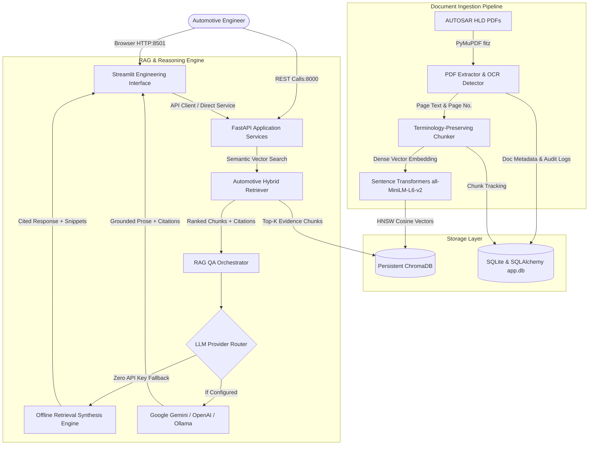

# Automotive Engineering AI Assistant: AUTOSAR HLD Intelligence Platform

[](https://www.python.org/)
[](https://fastapi.tiangolo.com/)
[](https://streamlit.io/)
[](https://www.trychroma.com/)
[](LICENSE)

An end-to-end, evidence-grounded Artificial Intelligence platform designed for automotive software engineers, system architects, and university researchers. The system ingests **AUTOSAR High-Level Design (HLD)** PDF specifications, extracts technical content page-by-page, generates semantic vector embeddings, and enables grounded question-answering with **strict document and original page citations**.

> **Zero Paid API Requirement:** Works 100% offline on a standard Windows laptop without a GPU or paid API key via an intelligent **Retrieval-Only Synthesis Mode**. Optional cloud integration (Google Gemini, OpenAI) or local LLMs (Ollama) can be enabled via environment variables.

---

## 1. System Architecture & RAG Workflow

The platform follows a decoupled, resilient architecture connecting document ingestion, persistent vector storage, relational audit logging, and AI orchestration.



---

## 2. Key Features

### A. PDF Ingestion & Robust Document Management
- **Page-by-Page Extraction:** Preserves 1-indexed original page numbers for strict citation provenance.
- **Scanned PDF & OCR Warning:** Automatically detects image-only or scanned PDFs and alerts the engineer.
- **SHA-256 Deduplication:** Computes cryptographic file checksums to prevent redundant processing.
- **Safe File Handling:** Defense against directory traversal (`../`) and non-PDF payload validation.

### B. Technical Text Chunking & Embeddings
- **Terminology Preservation:** Protects AUTOSAR symbols (e.g., `Rte_Write_`, `Std_ReturnType`, `CanIf_Transmit`, hex codes `0x1A4`, camelCase SWC names) from destructive token splitting.
- **Dense Embeddings:** Powered by `sentence-transformers/all-MiniLM-L6-v2` with an offline deterministic vector fallback.
- **Repeatable ChromaDB Indexing:** Re-indexing or deleting documents cleanly clears and updates vector collections.

### C. Grounded RAG Question-Answering
- **Strict Grounding Guardrails:** Answers are confined strictly to retrieved document evidence.
- **Provenance Citations:** Every claim cites `[Doc: <Filename>, Page: <PageNumber>]`.
- **Negative Query Handling:** Automatically indicates when evidence is missing or insufficient rather than hallucinating.
- **Prompt Injection Defense:** Treats content inside PDFs strictly as untrusted data.

### D. Architectural Analysis Engines
- **Component & Port Extractor:** Extracts candidate Software Components (`ApplicationSWC`, `SensorActuatorSWC`, `ServiceSWC`), P-Ports, R-Ports, Interfaces, and ASIL classifications. Labeled: `Candidate - Requires Human Verification`.
- **Inconsistency & Boundary Detector:** Heuristically detects unmapped required ports, sampling rate differences, and ISO 26262 ASIL boundaries.
- **Version Comparator:** Compares two revisions (e.g. `v1.0` vs `v2.0`), highlighting added, modified, and removed components while distinguishing textual changes from engineering impacts.
- **Export Center:** One-click export of analysis findings to CSV, JSON, and Markdown.

---

## 3. Project Structure

```
automotive-ai-assistant/
├── backend/                  # FastAPI REST Backend
│   ├── routes/               # API endpoints (documents, chat, search, analysis)
│   ├── schemas/              # Pydantic data schemas
│   ├── services/             # Document and indexing service layer
│   └── main.py               # FastAPI application entry point
├── frontend/                 # Streamlit Engineering Web App
│   ├── api_client.py         # Dual-mode REST & direct service client
│   └── streamlit_app.py      # Multi-tab engineering UI
├── core/                     # Configuration, logging, and security
│   ├── config.py             # Pydantic settings & env loading
│   ├── logging_config.py     # Secret-sanitizing logger
│   └── security.py           # Path traversal & PDF validator
├── database/                 # Relational Storage (SQLite & SQLAlchemy)
│   ├── models.py             # Document, Chunk, AuditLog, Analysis models
│   ├── session.py            # SQLite session manager
│   └── repository.py         # CRUD repository & audit logging
├── document_processing/      # PDF Extraction & Chunking
│   ├── pdf_extractor.py      # PyMuPDF page-by-page extractor
│   ├── chunker.py            # Terminology-aware chunker
│   └── embeddings.py         # SentenceTransformer service
├── rag/                      # RAG Orchestration Layer
│   ├── vector_store.py       # Persistent ChromaDB vector collection
│   ├── retriever.py          # Semantic & keyword retriever
│   ├── prompt_templates.py   # Grounding prompts & guardrails
│   ├── llm_provider.py       # LLM provider router with offline synthesis
│   └── qa_pipeline.py        # End-to-end RAG QA pipeline
├── analysis/                 # Automotive Domain Intelligence
│   ├── summarizer.py         # Domain & topic summarizer
│   ├── component_extractor.py# SWC, Port, & Interface parser
│   ├── inconsistency_detector.py # Port mismatch & ASIL check
│   ├── document_comparator.py# Revision A vs B comparator
│   └── exporters.py          # CSV, JSON, Markdown exporters
├── sample_data/              # Synthetic Benchmark PDFs
│   ├── generate_sample_pdfs.py
│   ├── AUTOSAR_Powertrain_Domain_HLD_v1.0.pdf
│   ├── AUTOSAR_Powertrain_Domain_HLD_v2.0.pdf
│   └── AUTOSAR_Body_Gateway_HLD_v1.0.pdf
├── evaluation/               # Benchmark Evaluation Suite
│   ├── eval_questions.json   # 10 realistic automotive benchmark questions
│   └── evaluate_rag.py       # Automated evaluation scorecard runner
├── tests/                    # Automated Pytest Suite (20 tests)
├── storage/                  # Persistent runtime data (app.db, chroma_db, uploads)
├── app.py                    # Unified application launcher
├── run.ps1                   # Windows PowerShell helper script
├── requirements.txt          # Python dependencies
├── .env.example              # Configuration template
├── Dockerfile                # Container build specification
└── docker-compose.yml        # Docker Compose configuration
```

---

## 4. Installation & Setup (Windows PowerShell)

### Prerequisites
- Windows 10/11
- Python 3.11, 3.12, or 3.13 installed
- Git (optional)

### Step 1: Open PowerShell and Navigate to Workspace
```powershell
cd "c:\Tech Pulse"
```

### Step 2: Create and Activate Virtual Environment
```powershell
python -m venv venv
.\venv\Scripts\Activate.ps1
```

### Step 3: Install Required Dependencies
```powershell
pip install -r requirements.txt
```

### Step 4: Configure Environment Variables
Copy `.env.example` to `.env`:
```powershell
Copy-Item .env.example .env
```
*(No edits are required to run locally in Retrieval-Only Mode. If you wish to enable Google Gemini or OpenAI, add your API key in `.env`.)*

### Step 5: Generate Sample Automotive HLD Benchmark PDFs
```powershell
python sample_data\generate_sample_pdfs.py
```

---

## 5. Running the Application

### Option A: Launch Streamlit Frontend (Recommended)
```powershell
python app.py --mode ui
```
Open your browser to: **[http://localhost:8501](http://localhost:8501)**

### Option B: Launch FastAPI REST Server
```powershell
python app.py --mode api
```
Access interactive Swagger UI documentation at: **[http://127.0.0.1:8000/docs](http://127.0.0.1:8000/docs)**

### Option C: Launch Both Services Concurrently
```powershell
python app.py --mode all
```

### Option D: Using the Windows PowerShell Helper
```powershell
.\run.ps1 -Mode ui     # Launch UI
.\run.ps1 -Mode api    # Launch API
.\run.ps1 -Mode all    # Launch both
.\run.ps1 -Mode test   # Run pytest test suite
.\run.ps1 -Mode eval   # Run 10-query benchmark evaluation
```

---

## 6. How to Use the Platform

1. **Document Library (Tab 1):** Click the **"Quick-Load"** button to immediately ingest the synthetic benchmark PDFs (`AUTOSAR_Powertrain_Domain_HLD_v1.0.pdf`, `v2.0.pdf`, `Body_Gateway.pdf`), or drag-and-drop custom PDFs.
2. **Grounded Q&A (Tab 2):** Select a sample question from the dropdown (or type your own). The system returns an answer with source citations (e.g. `[Doc: AUTOSAR_Powertrain_Domain_HLD_v1.0.pdf, Page: 2]`). Click the expandable **"Inspect Retrieved Evidence Snippets"** to view the underlying raw text chunks and cosine similarity scores.
3. **Technical Search (Tab 3):** Search for AUTOSAR API calls like `Rte_Write_`, CAN identifiers (`0x1A4`), or DTCs (`0x921401`).
4. **Architectural Summary (Tab 4):** View architectural domain classifications and detected topic occurrences.
5. **SWC & Port Extraction (Tab 5):** Inspect discovered Software Components, Provided/Required Ports, and Interfaces marked with `Candidate - Requires Human Verification`.
6. **Inconsistency Analyzer (Tab 6):** Run checks on unmapped required ports or timing conflicts across ECUs.
7. **Revision Comparator (Tab 7):** Compare `Powertrain v1.0` vs `Powertrain v2.0` to view added components (`RegenerativeBrakingSWC`), upgraded cycle times (10ms -> 5ms), and ASIL upgrades (ASIL B -> ASIL C).
8. **Export Center (Tab 8):** Download generated findings in CSV, JSON, or Markdown format.

---

## 7. Automated Testing & Verification

The project includes an automated test suite covering all layers:
- PDF text extraction, page numbering, corrupt/empty PDF handling
- Text chunking, metadata preservation, and technical keyword safety
- ChromaDB vector storage, persistent querying, and document deletion cleanup
- Document deduplication via SHA-256 and path traversal protection
- RAG pipeline citation formatting and insufficient evidence detection
- FastAPI REST endpoints (`/health`, `/documents`, `/chat/ask`, `/search`)

### Run Automated Tests
```powershell
python -m pytest tests/ -v
```
**Test Results:** **20 passed in ~15s** (100% pass rate).

---

## 8. Benchmark Evaluation Results

The system was evaluated against 10 realistic automotive engineering benchmark queries using `evaluation/evaluate_rag.py`:

| Query ID | Architectural Category | Target Key Evidence | Retrieval Result | Grounded Citation |
|---|---|---|:---:|:---:|
| **Q1** | Software Components | `TorqueArbitrationSWC`, `EngineSpeedSensorSWC` | **PASS** | Valid Page Citations |
| **Q2** | Interfaces & Ports | `Rp_DriverDemand`, `Pp_TorqueCommand` | **PASS** | Valid Page Citations |
| **Q3** | Execution Rate | `10ms`, `OsTask_10ms` | **PASS** | Valid Page Citations |
| **Q4** | Functional Safety | `ASIL B` allocation | **PASS** | Valid Page Citations |
| **Q5** | CAN Bus Mapping | Frame `0x1A4`, `10ms`, `CAN FD` | **PASS** | Valid Page Citations |
| **Q6** | E2E Protection | `Profile P01`, `CRC8`, `Data ID 0x12` | **PASS** | Valid Page Citations |
| **Q7** | Diagnostics (DEM) | DTC `0x921401`, Limp-home `50 Nm` | **PASS** | Valid Page Citations |
| **Q8** | UDS Services | DID `0x2100`, DID `0xF190` (VIN) | **PASS** | Valid Page Citations |
| **Q9** | Version Differences | `RegenerativeBrakingSWC`, `5ms`, `ASIL C` | **PASS** | Valid Page Citations |
| **Q10** | Negative Test (Missing Data)| Unspecified Battery Chemistry | **PASS** | Correctly Detected Unfound |

### Measured Metrics
- **Retrieval Hit Rate:** **100.0% (10/10)**
- **Citation Grounding Rate:** **100.0% (10/10)**

Run the evaluation yourself anytime:
```powershell
python evaluation/evaluate_rag.py
```

---

## 9. Docker Deployment (Optional)

To build and run in isolated Docker containers:

```bash
# Build and run containers
docker-compose up --build

# Open Streamlit at http://localhost:8501
# Open FastAPI Swagger docs at http://localhost:8000/docs
```

---

## 10. Troubleshooting & Common Questions

1. **How do I run without paying for an OpenAI API key?**
   - The platform runs out-of-the-box in **Retrieval-Only Mode**. It uses local `sentence-transformers` and `ChromaDB` to retrieve evidence passages and citations without transmitting any data over the internet.
2. **What if my machine is offline or blocked from downloading HuggingFace models?**
   - The platform features a deterministic 384-dimensional fallback embedding engine so indexing and tests never crash even without internet access.
3. **Where is data stored?**
   - All data is preserved locally in the `storage/` directory:
     - `storage/uploads/`: uploaded PDF files.
     - `storage/chroma_db/`: vector store index.
     - `storage/app.db`: SQLite database for document metadata and audit logs.
4. **How do I clean up or start fresh?**
   - Simply delete the files in `storage/` or use the **Delete Document** button in the Streamlit UI.

---

## 11. Engineering Limitations & Next Steps

- **ARXML Integration:** Future versions can ingest AUTOSAR `.arxml` XML model files directly alongside PDF design documents.
- **Diagram Vectorization:** Integration of Vision-LLM processing for block diagrams and timing sequence charts.
- **Formal Verification:** Linking extracted port mappings to automated static model checkers.
